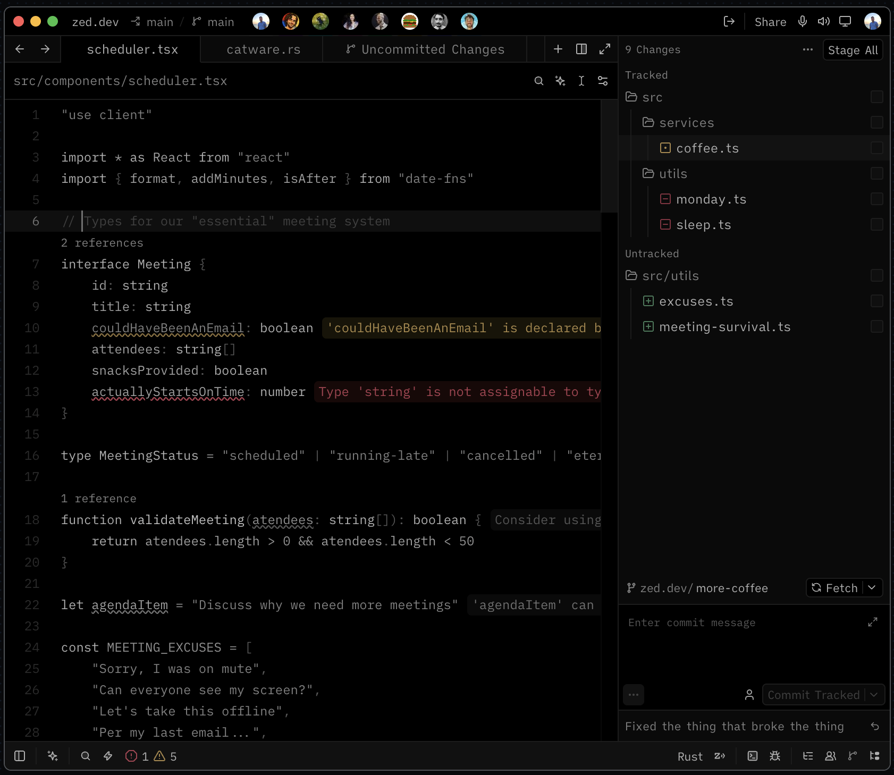
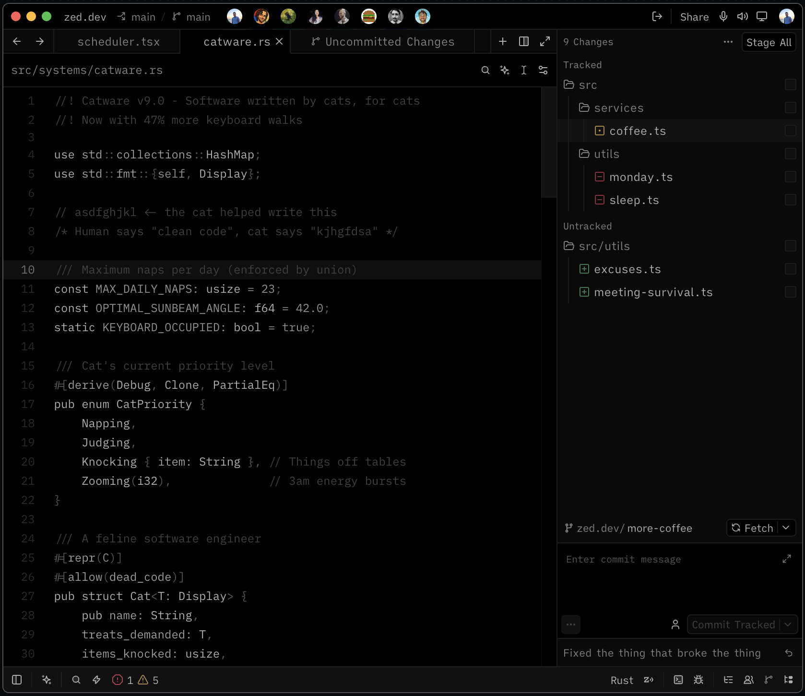
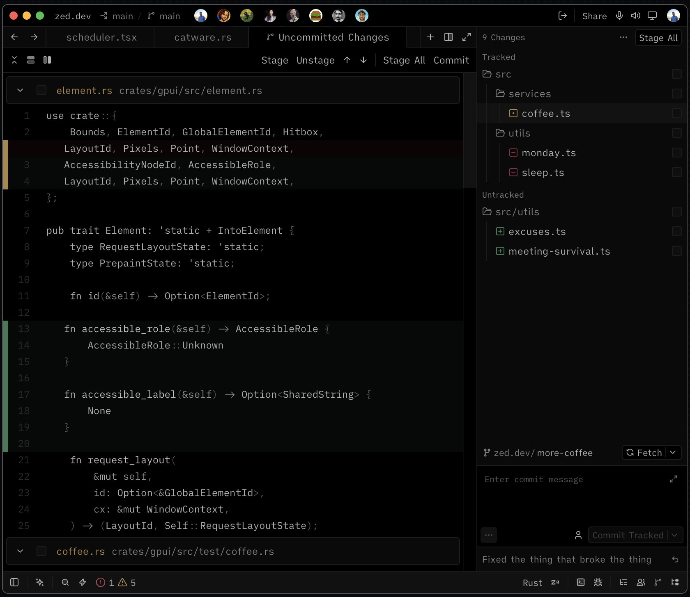
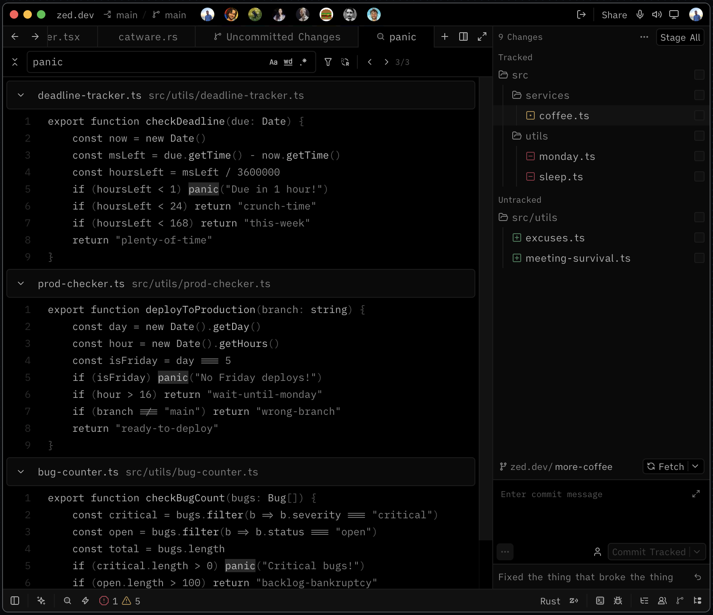

  

<h1 align="center">Blackberry Night</h1>

A true black night theme with dark grey tones for Zed editor.

## Screenshots

## Installation

1. Open Zed
2. Go to Extensions (`cmd + shift + x`)
3. Search for **Blackberry Night**
4. Click Install

## Color Palette

| Usage | Color |
|-------|-------|
| Background | `#000000` |
| Variables | `#c8c8c8` |
| Strings | `#a0a0a0` |
| Functions | `#c0c0c0` |
| Keywords | `#b0b0b0` |
| Control flow | `#b0b0b0` |
| Types | `#b0b0b0` |
| Comments | `#707070` |

## Author

Made by [rangaNP](https://github.com/rangaNP)
